# MIND BENCH

[](https://github.com/yuchen0x1/mind-bench/actions/workflows/ci.yml)
[](https://github.com/yuchen0x1/mind-bench/releases/latest)
[](LICENSE)

**把同一道题交给多个 AI，保存原始回答，用可追溯的规则比较它们。** 本项目在你自己的电脑上运行，适合模型选型、提示词改进、回归评测和回答复核。

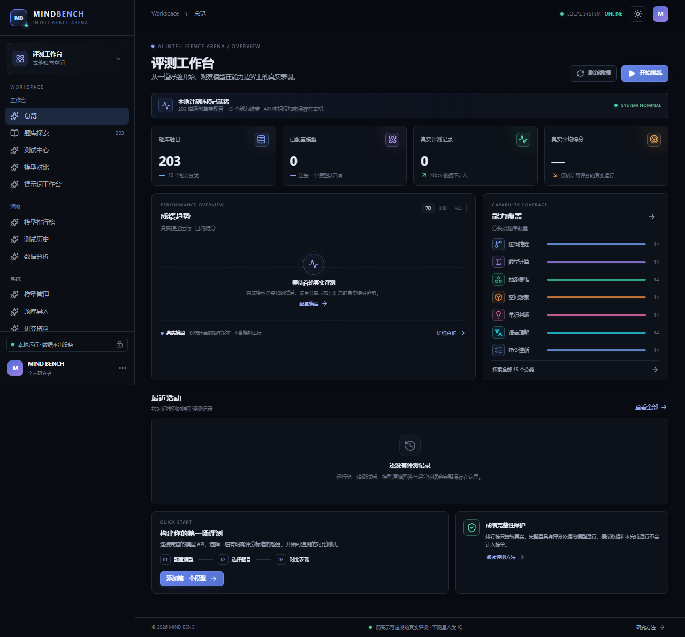

## 你可以用它做什么

| 你想完成的事 | 在 MIND BENCH 中怎么做 |
| --- | --- |
| 比较两个模型谁更适合某类任务 | 添加模型 → 选同一批题 → 多模型测试 → 并排比较回答与评分 |
| 改进自己的提示词 | 复制题目 → 在提示词工作台编辑 → 保存版本与变体 → 重复测试 |
| 检查模型升级后是否退步 | 固定题目与参数 → 保存运行清单 → 按运行时模型版本查看结果 |
| 检查开放式回答质量 | 规则评分 → 选择其他模型匿名裁判 → 人工复核 → 导出报告 |
| 不配置 Key 先体验流程 | 添加 Mock 供应商和模型 → 运行单题 → 查看明确标记的模拟报告 |

## 最新更新

### 0.2.1 · 2026-11-13

首个公开版本，支持带来源的题库、多模型评测、三层评分、可复现运行清单和报告导出。报告可自动刷新并停止测试，历史裁判使用运行时题目快照。提供完整的前后端发布包与 MIT 许可证。

[完整发布记录](docs/releases/release-notes.md) · [下载最新版本](https://github.com/yuchen0x1/mind-bench/releases/latest) · [提交问题](https://github.com/yuchen0x1/mind-bench/issues)

## 第一次使用：5 分钟走通流程

1. 安装 **Node.js 24+**。下载 Release 中的 `mind-bench-0.2.1.tar.gz` 并解压。
2. 在解压目录执行 `npm ci --omit=dev`，再执行 `npm start`，打开 <http://127.0.0.1:3000>。
3. 在「模型管理」添加供应商和模型。先体验可选「Mock 沙盒」，真实评测再配置自己的供应商地址与 API Key。
4. 打开「题库探索」→ 选择一题 → 勾选模型 →「发送测试」。也可在「测试中心」组织批量测试。
5. 在「测试历史」打开报告，查看原始回答、运行清单和评分，按需发起 AI 裁判、人工复核或导出 JSON/CSV。

Release 已包含构建好的界面。若从 Git 克隆源码，请改用 `npm ci` → `npm run build` → `npm start`。

MIND BENCH（AI 智力评测竞技场）是一个**可真实运行**的本地 AI 模型评测工作台：维护带来源、许可与版本信息的题库，调用你自己配置的模型 API，完整保存原始回答与运行元数据，用确定性规则 + AI 裁判 + 人工复核三层机制评分，并输出可追溯的排行榜。

它不是静态演示页，也不是截图站。每个主要按钮都有对应的后端行为，所有分数都由真实运行记录聚合得出；没有运行记录时排行榜**会诚实地留空**，而不是塞入示例数据。

> **解释边界（重要）：** MIND BENCH SCORE 是本平台定义的实验性模型评测分数（0—100 分制，可换算为 0—1000），**不是**人类 IQ、不构成心理测量结果，也不是权威模型排行榜。内置 203 道题为原创草案/待复核状态，不应据此发布严肃的能力排名。Mock 供应商只用于流程验证，界面会明确标注 `MOCK`，不参与评分、不进入正式榜单。

---

## 目录

- [功能状态](#功能状态)
- [界面截图](#界面截图)
- [技术架构](#技术架构)
- [快速开始](#快速开始)
- [配置模型供应商](#配置模型供应商)
- [评分体系](#评分体系)
- [排行榜与权重](#排行榜与权重)
- [题库与数据导入](#题库与数据导入)
- [数据库](#数据库)
- [开发与测试](#开发与测试)
- [环境变量](#环境变量)
- [已知限制](#已知限制)
- [文档与许可证](#文档与许可证)

---

## 功能状态

下表的"状态"列区分了**已实现并验证**、**已实现但缺真实 Key 验证**、**未实现**三种情况。这是刻意的诚实标注。

| 模块 | 能力 | 状态 |
| --- | --- | --- |
| 题库 | 203 道原创题 / 15 个一级分类 / 4 档难度 / 20 字段结构 / 来源与许可记录 | ✅ 已实现 |
| 题库 | 搜索、分类筛选、难度筛选、卡片/列表双视图、收藏 | ✅ 已实现 |
| 题库 | 单题详情：中英文提示词、目标、参考答案、评分规则、常见错误、版本历史、变体 | ✅ 已实现 |
| 题库 | 复制为新题（真实落库）、编辑副本、变体管理、版本快照 | ✅ 已实现 |
| 题库 | JSON 导入/导出、外部数据集（JSONL/CSV）适配、许可证强制 | ✅ 已实现 |
| 供应商 | 13 种类型：OpenAI / Anthropic / Gemini / DeepSeek / 智谱 / Moonshot / MiniMax / 通义千问 / OpenRouter / Ollama / LM Studio / OpenAI 兼容 / Mock | ✅ 已实现 |
| 供应商 | 测试连接、**从供应商接口获取模型列表**、默认模型、成本配置 | ✅ 已实现 |
| 供应商 | API Key AES-256-GCM 加密存储，API 永不返回明文 | ✅ 已实现 |
| 测试 | 8 种模式：单题 / 分类 / 综合 / 极限 / 随机 / 稳定性 / 自定义 / 外部回答 | ✅ 已实现 |
| 测试 | 单模型、多模型、全部模型、重复测试、手动粘贴外部回答 | ✅ 已实现 |
| 测试 | 并发控制、超时、取消、单模型失败隔离 | ✅ 已实现 |
| 测试 | 原始回答完整保存（不改写、不猜测隐藏思维链） | ✅ 已实现 |
| 测试 | 可复现运行清单：题目/模型/参数/评分/环境快照、SHA-256 完整性摘要、JSON 导出 | ✅ 已实现 |
| 发布 | 完整前后端压缩包、逐文件摘要、Web 版本检测、Windows/Linux CI 和标签发布工作流 | ✅ 已实现 |
| 评分 | 确定性规则 10 种：exact / one_of / contains / all_keywords / any_keywords / numeric / regex / json / word_limit / manual | ✅ 已实现 |
| 评分 | **AI 裁判**：匿名化候选、固定 Rubric、严格 JSON、服务端重算总分、多裁判交叉验证 | ✅ 已实现 |
| 评分 | 人工评分与复核，人工分不被 AI 覆盖 | ✅ 已实现 |
| 对比 | 并排卡片、LCS 逐词差异高亮、逐项评分矩阵、两两对比 | ✅ 已实现 |
| 排行榜 | 分类加权、覆盖度、趋势、版本过滤、qualifying/provisional 分级、CSV/JSON 导出 | ✅ 已实现 |
| 工作台 | 提示词工作台：三栏编辑 + 实时评分预览 + 变体 | ✅ 已实现 |
| 模型档案 | 雷达图、得分走势、最近运行、成功率、参数与成本 | ✅ 已实现 |
| 数据 | 19 张表、外键、唯一约束、索引、迁移、审计日志 | ✅ 已实现 |
| 部署 | Dockerfile + Compose（已实际 `docker build` 通过） | ✅ 已实现 |
| 真实模型 | 真实供应商联网调用与计费 | ⚠️ 未验证（无 Key） |
| 代码沙箱 | 在沙箱中执行模型生成的代码 | ❌ 未实现 |
| 认证 | 账号体系、多租户、远程访问防护 | ❌ 未实现（单机本地应用） |

---

## 界面截图

以下均为本地实际运行界面的 Chromium 截图，**不是设计稿**。总览、题库、单题与测试中心展示无真实用户数据的本地实例；工作台、模型管理、设置和 Mock 报告取自隔离实例的实际操作。截图使用回环端口与临时数据库，不展示真实 Key 或私人回答，Mock 不代表模型成绩。

### 总览仪表盘

顶部总览展示真实记录数量；还没有运行时，会显示引导和空状态，不填充虚构成绩。完整截图见本文开头。

### 题库探索


### 单题详情与测试

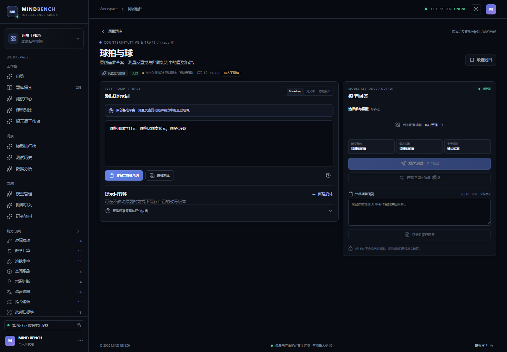

阅读提示词、参考答案与评分依据，选择模型后发送测试。

### 组织批量测试

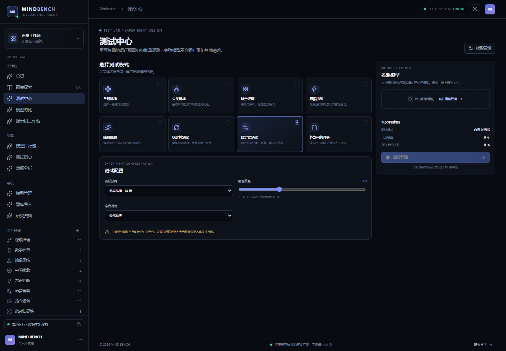

选择分类、难度、题量、模型与重复次数，用同一套配置组织可复现的评测。

### 提示词工作台

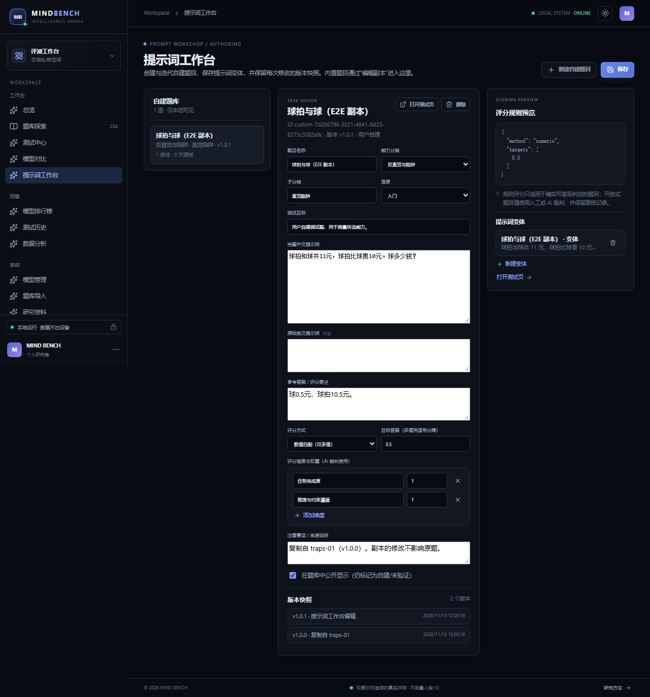

### 模型管理与供应商发现

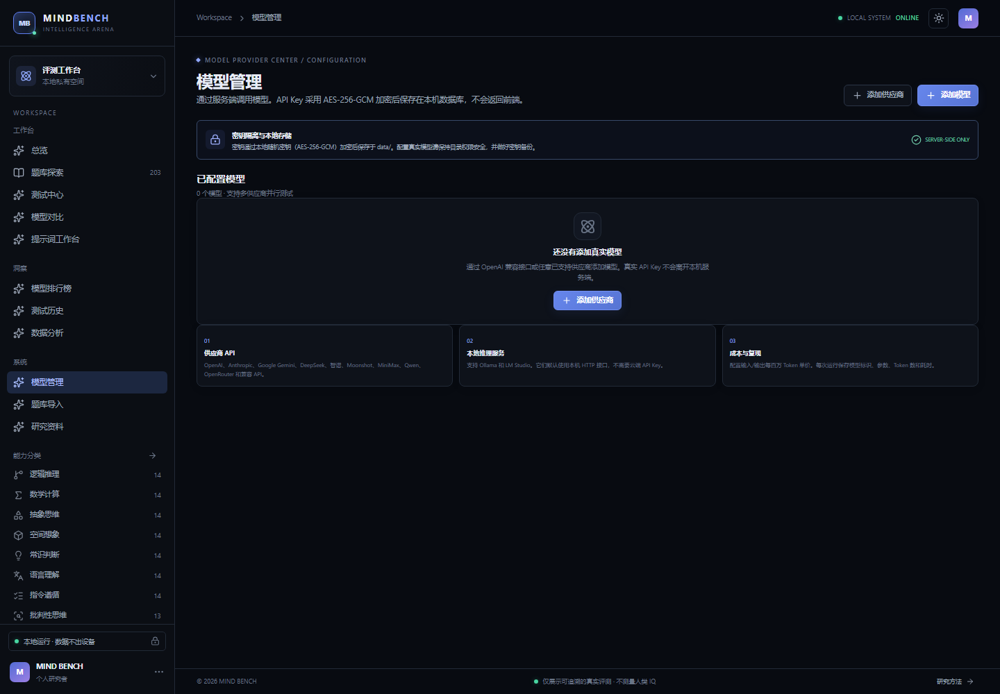

### Mock 运行报告（带 MOCK 标注）

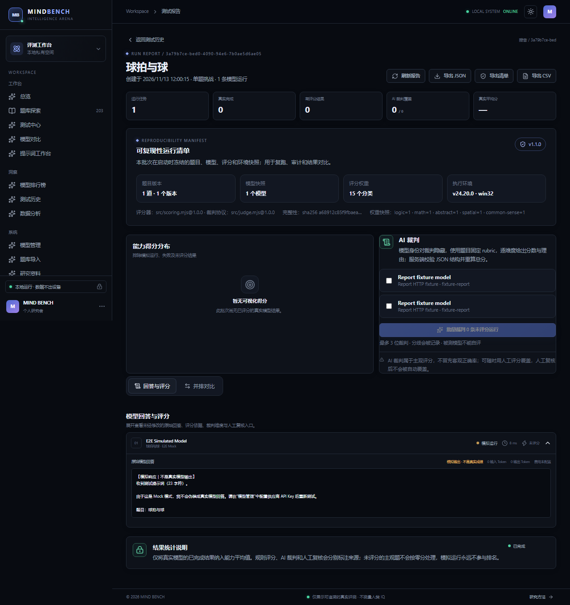

### 无真实样本时的排行榜（诚实留空）

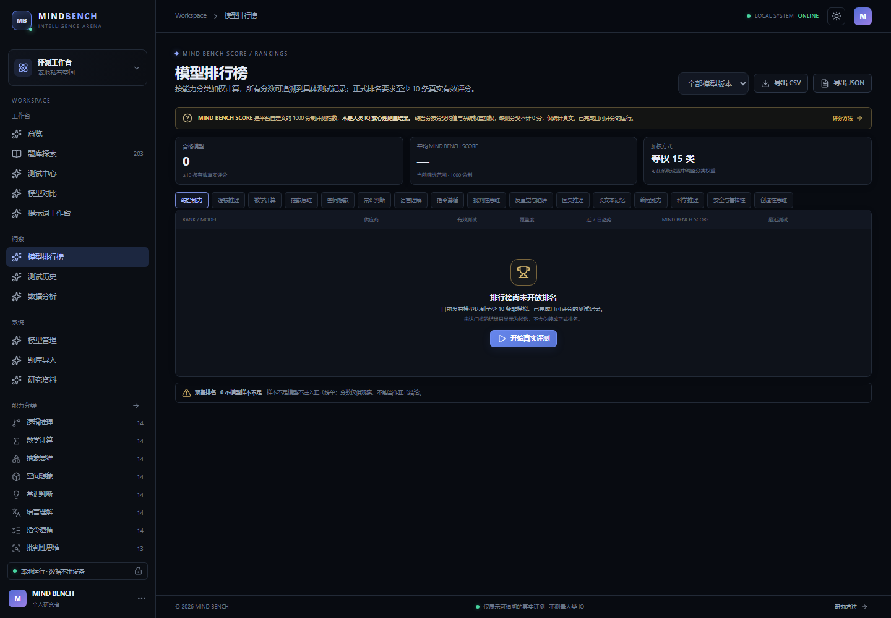

### 系统设置

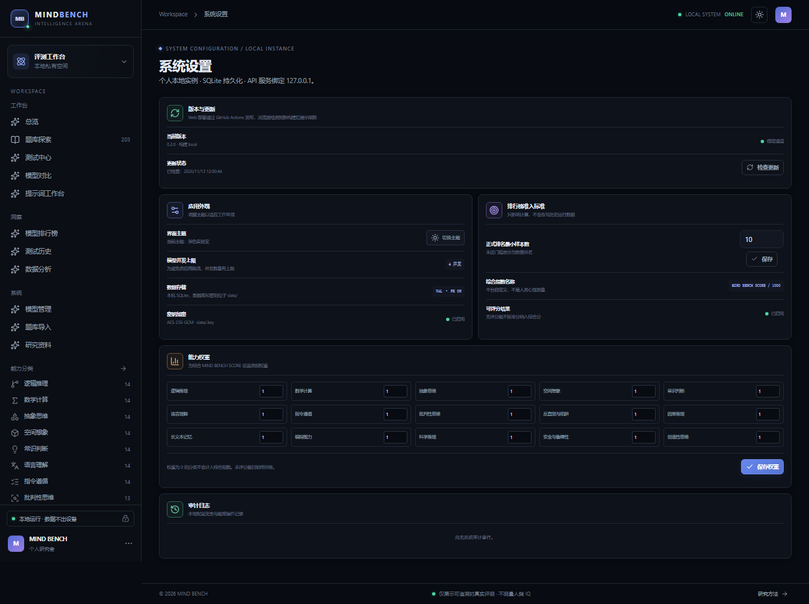

### 研究资料

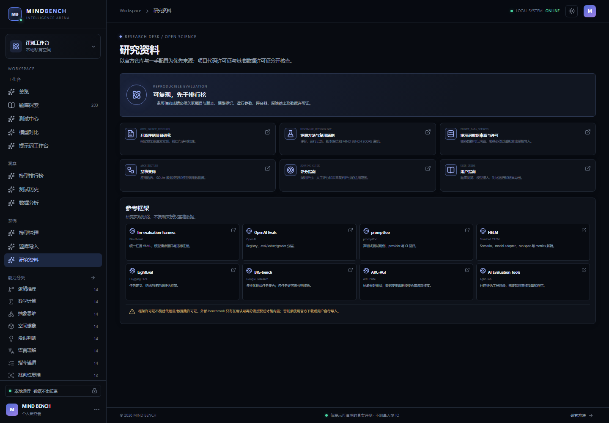

### 移动端适配

<p>
  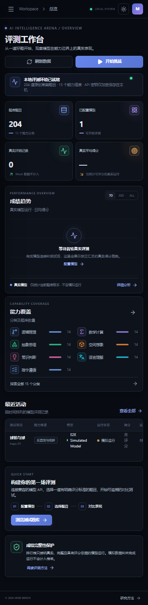
  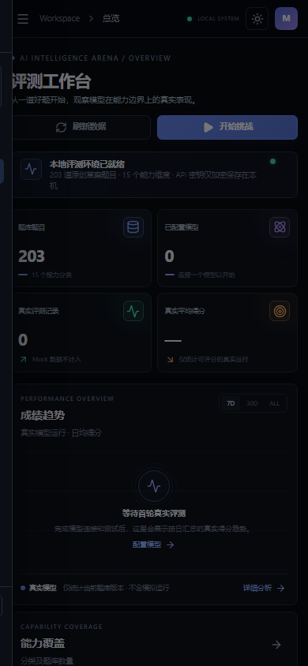
</p>

---

## 技术架构

```text
┌──────────────────────────────────────────────────────────┐
│  React 19 + Vite 8  (Hash 路由单页应用)                   │
│  Framer Motion 动效 · Recharts 雷达/趋势图 · lucide 图标  │
│  深色 / 浅色主题 · 桌面 / 平板 / 手机三档断点              │
└───────────────────────────┬──────────────────────────────┘
                            │ 同源 JSON API（50+ 个端点）
┌───────────────────────────┴──────────────────────────────┐
│  Express 5 (src/server.mjs)                              │
│  ├── 路由与校验：限流、8MB body、CSP/nosniff/DENY         │
│  ├── 供应商适配器 (src/providers.mjs)                     │
│  │     OpenAI 兼容 / Anthropic Messages / Gemini          │
│  │     generateContent / Ollama / LM Studio / Mock        │
│  ├── 评分引擎 (src/scoring.mjs)  确定性规则                │
│  ├── AI 裁判 (src/judge.mjs)     匿名 + Rubric + 重算      │
│  └── 并发池 asyncPool + AbortController 取消/超时          │
└───────────────────────────┬──────────────────────────────┘
                            │ node:sqlite（WAL, 外键开启）
┌───────────────────────────┴──────────────────────────────┐
│  SQLite · data/mind-bench.sqlite · 19 张表                │
│  AES-256-GCM 加密密钥 · data/.key                         │
└──────────────────────────────────────────────────────────┘
```

设计细节见 [架构说明](docs/ARCHITECTURE.md)、[评分指南](docs/SCORING_GUIDE.md)、[基准方法论](docs/BENCHMARK_METHODOLOGY.md)、[开源项目研究](docs/OPEN_SOURCE_RESEARCH.md)。

---

## 快速开始

**环境要求：** Node.js 24 或更新版本；本项目使用内置 `node:sqlite`，无需另外安装数据库。以下命令适用于 Git 克隆的源码；Release 压缩包无需重新构建。

### Windows（PowerShell / Windows Terminal）

```powershell
npm ci
npm run build
npm start
```

打开 <http://127.0.0.1:3000>。`Ctrl+C` 停止。

### macOS / Linux

```bash
npm ci
npm run build
npm start
```

服务刻意绑定回环地址（`127.0.0.1`），只对本机开放。首次运行会在 `data/` 下创建 SQLite 数据库与本地密钥文件。

### 开发模式（热更新）

需要两个终端：

```bash
# 终端 1：API
npm run server
```

```bash
# 终端 2：Vite 开发服务器
npm run dev
```

打开 <http://127.0.0.1:5173> 即可使用完整热更新界面。Vite 已将 `/api` 代理至 `http://127.0.0.1:3000`，API 进程需要保持运行。如后端使用其他端口，在启动 Vite 前设置 `MIND_BENCH_API_TARGET`（PowerShell 示例：`$env:MIND_BENCH_API_TARGET="http://127.0.0.1:3100"`）。

### Docker

镜像已实际构建并运行通过：

```bash
docker build -t mind-bench:local .
docker run --rm -p 127.0.0.1:3000:3000 -v mind-bench-data:/data mind-bench:local
```

或使用 Compose（同样只绑回环）：

```bash
docker compose up --build
```

- 容器内 `HOST=0.0.0.0`（容器网络需要），但端口映射限定在 `127.0.0.1`。
- 数据持久化在命名卷 `mind-bench-data`，挂载到 `/data`。
- 以非 root 用户 `node` 运行。
- 内置 healthcheck 请求 `/api/health`。
- 自定义加密秘密：`-e MIND_BENCH_SECRET=...`。

⚠️ 公网/共享部署前仍需身份认证、TLS、CSRF 校验、SSRF 防护与数据访问控制，见 [架构与信任边界](docs/ARCHITECTURE.md)。

### AI 编程工具一键启动

在支持终端的 AI 编程工具中打开项目目录，让它依次执行：检查 `node -v` → `npm ci` → `npm run build` → `npm start` → 访问 `http://127.0.0.1:3000`。**不要**把供应商 API Key 粘贴进聊天记录、代码或版本控制；Key 只应通过界面「模型管理」录入。

---

## 配置模型供应商

1. 打开「模型管理」→「添加供应商」。
2. 选择类型（如 `openai-compatible`、`deepseek`、`ollama`），填写显示名、Base URL、API Key。
3. 保存后点「测试连接」验证连通性。
4. 点「获取模型列表」——平台会按供应商类型请求对应发现端点（`/models`、`/api/tags`、`/v1beta/models`），从返回结果中挑选模型加入。
5. 为每个模型配置显示名、温度、最大 Token、超时、重试与输入/输出成本（每百万 Token）。成本是**用户填写的估算值**，不是账单核验值。
6. 可设置一个默认模型；可批量选择多个模型一起跑同一批题。

**关于 Key 的安全性：**
- Key 使用 AES-256-GCM 加密后写入本机 SQLite，加密密钥来自 `data/.key` 或环境变量 `MIND_BENCH_SECRET`（经 `scryptSync` 派生）。
- 所有读取接口（`/api/providers`、`/api/models/:id` 等）只返回 `hasKey` 布尔值，**从不返回明文**。
- `data/.key` 与数据库必须一起备份；丢失密钥会导致已保存的 Key 无法解密。
- 切换 `MIND_BENCH_SECRET` 会使既有密文失效，需先完成迁移规划。

**Mock 供应商**：无需 Key，用于验证全流程。Mock 回答会在会话与报告中标注 `MOCK`，不参与评分、不进排行榜、不计入 AI 裁判候选池。

**外部回答**：在单题页粘贴其他平台的原始回答时，平台会保存为 `is_external=1` 的独立运行，允许统一评分、裁判和导出，但不会冒充所选模型的真实调用，也不会进入正式排行榜或真实模型统计。

> 真实供应商调用会按其服务条款产生流量与费用。本仓库未配置任何真实 API Key，因此真实模型调用与跨供应商分数可比性**尚未验证**。

---

## 评分体系

三层机制，明确区分"客观"与"主观"：

### 1. 确定性规则（客观）

由题目字段 `scoring_rule` 声明，服务端执行，结果可完全复现：

| 方法 | 说明 | 内置题数 |
| --- | --- | --- |
| `all_keywords` | 必须包含全部关键词 | 84 |
| `numeric` | 数值容差比较 | 40 |
| `contains` | 包含任一关键片段 | 25 |
| `exact` | 归一化后精确匹配 | 22 |
| `json` | JSON Schema 结构校验 | 5 |
| `regex` | 正则匹配 | 2 |
| `manual` | 需人工评分 | 25 |

统计：**178 / 203（87.7%）** 的题目可自动评分，其余 25 道为开放式主观题。

### 2. AI 裁判（主观但可审计）

`src/judge.mjs` 实现，用于开放式回答的辅助评分：

- **匿名化**：提示词中候选回答标记为 `Candidate A`，裁判**不知道**回答来自哪个模型，避免品牌偏好。
- **固定 Rubric**：维度来自题目 `scoring_dimensions`（默认「任务完成度 / 推理与约束遵循」），不允许裁判自行增删维度。
- **严格 JSON**：要求返回 `{dimensions:[{name,score,reason}],strengths,weaknesses}`。自由文本、缺维度、多出维度、分数越界、`mock:true` 一律 422 拒绝，**而不是给 0 分**——宁可不评分，也不污染数据。
- **服务端重算总分**：不信任模型自报的 `overall`，按维度权重重新加权计算。
- **禁止自评**：候选模型 ID 与裁判模型 ID 相同时直接拒绝。
- **多裁判交叉验证**：可同时选最多 3 个裁判，聚合输出均值、极差 `spread`、一致度 `agreement`，分歧过大时在报告页高亮提示。
- **可人工复核**：人工评分后 AI 裁判不会覆盖（除非显式 `force`）。
- **完整留痕**：`judge_verdicts` 表记录裁判模型 ID、模型版本、原始返回、解析结果与时间戳。

### 3. 人工评分

报告页对每条运行可手动打分并写评语，标记 `evaluator_type='human'`，进入排行榜时优先采信。

### 4. 可复现运行清单

每个测试会话在启动时保存不可变的 Run Manifest：

- 题目 ID、版本、分类、中英文提示词全文、参考答案、目标、评分规则与评分维度快照；
- 供应商、模型 ID、模型版本、温度、Token 上限、超时与重试参数；
- 当前评分权重、客观评分器/裁判协议版本、模型输入/输出单价，以及实际使用的覆盖提示词（如有）；
- Node.js、平台、架构、时区、并发上限和 Mock/外部回答标记；
- 对规范化清单计算的 SHA-256 完整性摘要。

新清单格式为 `1.1.0`。AI 裁判使用运行时保存的提示词、参考答案和量表，后续编辑题目不会改变这批运行的裁判依据；覆盖提示词也会纳入裁判。旧版清单缺少题目全文，仍沿用读取当前题目的兼容行为。

运行中的报告会自动刷新，可直接点击「停止测试」；排队任务会保存为取消状态，不再发送模型请求。

报告页展示清单摘要，`GET /api/sessions/:id/manifest` 可读取，报告 JSON 导出会内嵌清单，页面也支持单独导出 JSON。清单用于复跑与审计，不能把不同题库或权重版本的结果伪装成同一实验。

### 分数换算

单题得分 0—100 → 分类均值 → 按权重加权平均 → `weightedAverage × 10` → **0—1000 的 MIND BENCH SCORE**。

详细规则见 [评分指南](docs/SCORING_GUIDE.md)。

---

## 排行榜与权重

- **准入**：只有真实（非 Mock）、状态成功、已评分、且该分类有效样本数 ≥ `minimum_leaderboard_runs`（默认 10，可在「系统设置」修改）的运行才进入正式排名。
- **两级排名**：`qualified`（满足准入，参与排名）与 `provisional`（样本不足，单列展示且可点击查看模型档案，不占名次）。
- **分类加权**：15 个能力维度的权重来自 `system_settings.score_weights`，可在「系统设置」界面修改。报告页会显示权重来源，说明是否使用了非等权配置。
- **覆盖度**：每行显示已覆盖分类数 / 15，提示"分数基于部分能力"。
- **趋势**：近 7 日加权分 vs 前 7 日加权分的变化（`trend-up` / `trend-down`）。
- **版本过滤**：可按运行时保存的模型版本筛选；后续编辑模型配置不改变旧记录的版本归属。题目版本另保存在运行清单中，当前没有独立的题库版本筛选器。
- **导出**：`GET /api/leaderboard/export?format=csv|json`，含权重快照与阈值，便于复现。
- **原始记录可追溯**：从榜行展开可见 15 类分项条，点击进入模型档案，再进入具体测试报告。

> **不完整测试不会按 0 分混入。** 未完成、失败、未评分、Mock 的运行全部被排除在聚合之外，而不是当作 0 分参与平均。

---

## 题库与数据导入

### 内置题库

- 203 道原创题，15 个一级分类（逻辑推理、数学计算、抽象思维、空间想象、常识判断、语言理解、指令遵循、批判性思维、反直觉与陷阱、因果推理、长文本记忆、编程能力、科学推理、安全与鲁棒性、创造性思维），每类 13—14 题。
- 难度分布：入门 51 / 进阶 67 / 困难 65 / 专家 20。
- 每题携带 20 个字段：ID、名称、分类、子分类、难度、中文提示词、英文提示词、来源、来源仓库、许可证、目标、参考答案、评分规则、评分维度、常见错误、注意事项、版本、验证状态、是否公开、时间戳。
- 验证状态：178 题 `review_required`（待复核）、25 题 `draft`（草案）。

### 自建与编辑

在「提示词工作台」中可创建全新题目，或从任意内置题「编辑副本」——副本会真实写入数据库（`derived_from` 记录来源），随后可编辑提示词、目标、评分规则，左侧实时显示评分预览，右侧管理变体（同一考点的不同问法）。

### 外部数据集导入

「题库导入」页面支持两条路径：

1. **JSON 导入**：MIND BENCH 原生格式（`/api/tasks/export` 的产物）。
2. **外部数据集适配**：JSONL 或 CSV，需填写**许可证**（必填，强制校验），支持字段别名映射（如 `question`→`promptZh`、`answer`→`referenceAnswer`）。导入的题目 `verification_status='imported'`，每次最多 1000 条，逐条错误随结果返回。

⚠️ 导入前请自行确认数据集的再分发权与署名要求。**不要**把不可再分发的数据（如部分 MMLU/HellaSwag 变体）提交到公开仓库。参见 [第三方许可证清单](THIRD_PARTY_LICENSES.md) 与 [提示词与数据来源](docs/PROMPT_DATA_SOURCES.md)。

---

## 数据库

19 张表，关系完整，非"一个大 JSON"：

```text
users                  providers              models
benchmark_categories   benchmark_sources      benchmark_tasks
benchmark_task_versions  benchmark_test_cases  scoring_rubrics
test_sessions          test_runs              model_responses
evaluation_results     judge_verdicts         leaderboard_snapshots
favorites              custom_prompts         system_settings
audit_logs
```

要点：

- 外键全部开启（`PRAGMA foreign_keys=ON`），WAL 模式。
- `judge_verdicts` 有 `UNIQUE(run_id, judge_model_id)`，保证同一裁判对同一运行只保留一条（重复裁判为 UPSERT）。
- 索引覆盖 `run_id` / `task_id` / `model_id` / `created_at` / `variant task_id` 等高频查询。
- 轻量迁移：`src/db.mjs` 中 `ensureColumn()` 对既有库做幂等加列，不破坏历史数据。
- 删除保护：内置题禁止删除（403）；有运行记录的题禁止删除（409）；供应商删除前检查关联模型。

备份：干净停止服务后，同时复制 `data/mind-bench.sqlite`（及 `-wal` / `-shm`）与 `data/.key`。

---

## 开发与测试

```bash
npm test              # Vitest：单元 + API 集成
npm run build         # Vite 生产构建
npm run test:e2e:install   # 首次安装 Playwright Chromium
npm run test:e2e      # Playwright 端到端
```

**本地验证记录（2026-11-13；Docker 项保留此前记录，本轮未重测）：**

| 套件 | 结果 | 内容 |
| --- | --- | --- |
| `npm test` | **52 / 52 通过**（8 个文件） | 评分、裁判、供应商、API、快照、跨站请求、导入异常、计数、版本筛选、零权重等回归 |
| `npm run test:e2e` | **8 / 8 通过** | 总览→题库→单题→复制→Mock→报告→排行榜→工作台→设置→研究→移动端，以及报告自动刷新/取消 |
| `npm run build` | ✅ 成功 | — |
| `docker build` | ✅ 成功 | 镜像可用 |

测试隔离：`tests/setup.js` 将 `MIND_BENCH_DATA_DIR` 指向临时目录，`playwright.config.js` 同样注入隔离目录，**自动化测试不会写入或污染你的正式数据库**。

E2E 覆盖的真实路径（非 mock 掉的前端）：

1. 打开总览，校验 KPI 与图表渲染；
2. 浏览题库、切换视图、进入单题详情；
3. 点「复制为新题」验证真实落库并跳转工作台；
4. 创建 Mock 供应商 → 添加模型 → 测试连接；
5. 运行单题 → 等待完成 → 打开报告，校验 `MOCK` 标注；
6. 打开排行榜，校验无真实数据时为空而非伪造数据；
7. 在工作台编辑副本、保存、创建变体；
8. 修改排行榜最小样本阈值并保存；
9. 打开研究资料页，校验文档渲染；
10. 切换移动端视口，校验布局与导航抽屉。

---

## 环境变量

| 变量 | 默认值 | 说明 |
| --- | --- | --- |
| `PORT` | `3000` | HTTP 端口 |
| `HOST` | `127.0.0.1` | 绑定地址；Docker 内为 `0.0.0.0` |
| `MIND_BENCH_DATA_DIR` | `./data` | 数据库与密钥目录 |
| `MIND_BENCH_SECRET` | 无 | 每次启动时用于派生加密密钥；已有数据时必须保持一致，不可直接更换 |
| `MIND_BENCH_CONCURRENCY` | `4` | 并发模型调用数，上限 8 |
| `MIND_BENCH_API_TARGET` | `http://127.0.0.1:3000` | Vite 开发模式的 API 代理目标，不影响生产服务 |

---

## 安全设计

- **密钥**：AES-256-GCM 加密落库，密钥不返回前端；日志与错误信息不含 Key。
- **输入**：所有请求体经字段级校验与长度截断；SQL 全部使用预编译语句（参数绑定），无字符串拼接。
- **XSS**：React 默认转义；模型输出按纯文本渲染，不做 `dangerouslySetInnerHTML`。
- **不可信数据**：提示词与模型返回被视为不可信输入，AI 裁判解析失败即拒绝，不做兜底猜测。
- **限流**：每 IP 60 秒 240 次请求。
- **请求体**：上限 8MB。
- **安全头**：CSP、`X-Content-Type-Options: nosniff`、`X-Frame-Options: DENY`。
- **取消与超时**：前端提交后立即获得会话 ID，后端以后台任务执行；`AbortController` + `AbortSignal.timeout` 可中途取消，不留悬挂连接。
- **重试**：模型的 `max_retries` 对网络错误与 5xx 使用有限指数退避；4xx 和解析错误不会盲目重试。
- **审计**：关键操作写入 `audit_logs`。
- **代码执行**：平台**不会**在服务进程内执行模型生成的任何代码（无沙箱，因此也不提供"执行"按钮）。

---

## 已知限制

1. **无真实 Key 验证**：本仓库未配置真实 API Key，因此真实供应商联网调用、计费精度、跨供应商可比性均未验证。所有已通过的测试使用 Mock 或本地 stub。
2. **题库未经外部专家复核**：203 题均为原创草案，代表性、语言偏差、标准答案正确性需逐题人工审核。`review_required` 状态即表达此意。
3. **AI 裁判是辅助手段**：裁判模型自身也有偏好与噪声；多裁判只能降低而非消除偏差。裁判结果永远标记来源，不应被当作客观真值。
4. **无代码沙箱**：编程题只评"回答文本"，不执行代码，因此无法验证运行时正确性。
5. **单机应用**：无账号体系、无多租户、无远程访问防护。**不要**直接暴露到公网。
6. **旧版运行清单**：`1.0.0` 清单没有提示词与参考答案全文，历史 AI 裁判仍读取当前题目。新运行使用 `1.1.0` 快照，旧记录不会被重写。
7. **供应商协议覆盖不全**：除 OpenAI 兼容、Anthropic Messages、Gemini `generateContent`、Ollama、LM Studio 外，各厂商专有特性（如 Anthropic 的 prompt caching、Gemini 的 grounding）未实现。
8. **分数不可跨版本比较**：题库、评分规则或权重变化后，历史分数不应直接比较。排行榜支持模型版本过滤；题库差异需结合运行清单人工核对，不会自动归一化。
9. **成本为估算**：单价由用户填写，与实际账单可能存在差异。

---

## 文档与许可证

- [架构说明](docs/ARCHITECTURE.md) — 模块划分、信任边界、数据流
- [用户指南](docs/USER_GUIDE.md) — 逐页面操作说明
- [评分指南](docs/SCORING_GUIDE.md) — 三层评分机制、权重、换算
- [基准方法论](docs/BENCHMARK_METHODOLOGY.md) — 能力体系、采样、解释边界
- [测试数据指南](docs/TEST_DATA_GUIDE.md) — 出题规范、复核流程
- [提示词与数据来源](docs/PROMPT_DATA_SOURCES.md) — 来源分级 A/B/C/D/E
- [开源项目研究](docs/OPEN_SOURCE_RESEARCH.md) — lm-evaluation-harness、HELM、lighteval、promptfoo、OpenAI Evals、BIG-bench、ARC-AGI 的对照研究
- [自动更新与发布](docs/AUTO_UPDATE.md) — Web 版本检测、缓存策略、GitHub Actions、Release 与安全边界
- [API 参考](docs/API.md) — 48 个 HTTP 端点
- [更新日志](CHANGELOG.md) · [贡献指南](CONTRIBUTING.md)

**许可证：** 项目代码采用 [MIT](LICENSE)。内置原创题目沿用题库来源记录中的 `CC0-1.0`；外部导入数据按各自许可使用。第三方依赖见 [许可证清单](THIRD_PARTY_LICENSES.md) 与 [运行时 SBOM](docs/dependency-sbom.cdx.json)。**项目代码许可不替代外部数据集许可。** 安全问题请参阅 [SECURITY.md](SECURITY.md)。
